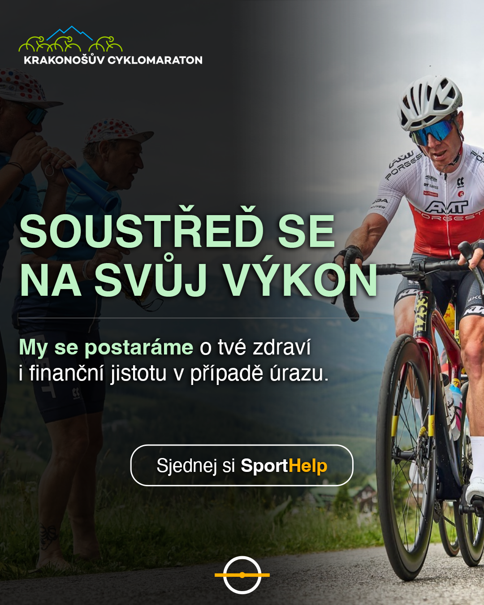
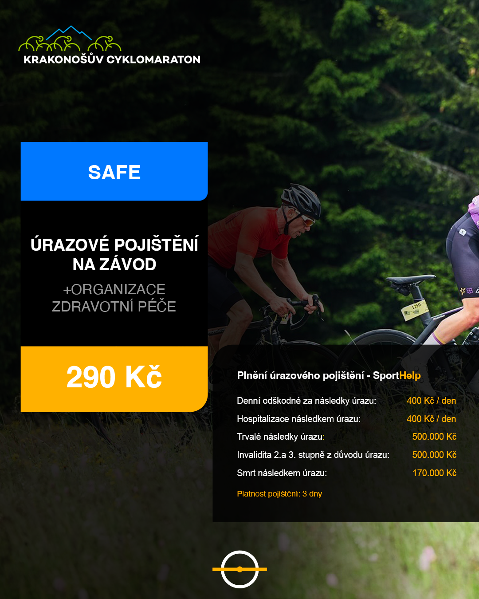
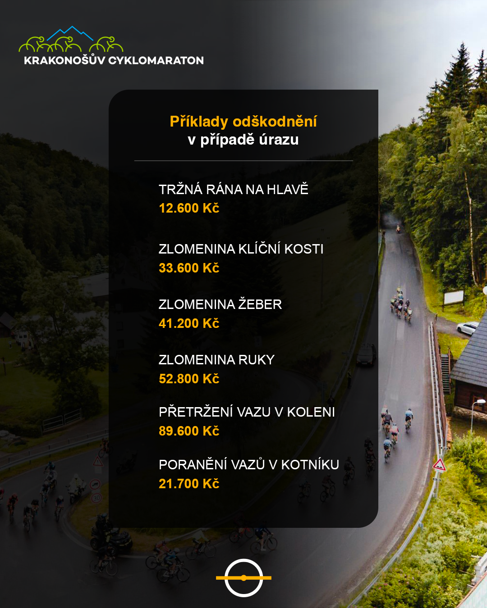

Letos poprvé se můžeš na start Krakonošova cyklomaratonu postavit s naprostým klidem. Díky nové spolupráci s SportHelp získáš možnost sjednat si špičkové sportovní pojištění, které tě ochrání při jakémkoli úrazu – ať už se stane během závodu nebo jinde. Ty se soustředíš na výkon, SportHelp se postará o zbytek.

### Závod bez starostí

Cílem každého cyklisty je dojet bezpečně a s co nejlepším časem. Bohužel ale víme, že i na nejlépe připraveného závodníka může číhat nečekaná komplikace. Co když přijde pád? Co když se něco pokazí?

Právě proto letos přichází na scénu SportHelp – česká služba, která kombinuje sportovní pojištění s organizací zdravotní péče a rehabilitací. V případě úrazu ti nejen pomůže získat odškodnění, ale rovnou ti i zajistí návštěvu lékaře, rehabilitaci a návrat zpět do formy.

### Proč si sjednat pojištění právě se SportHelp?

- **Kompletní servis v případě úrazu** – organizace zdravotní péče, rychlý přístup ke specialistům, poúrazový program, rehabilitace.
- **Rychlé vyřízení pojistného plnění** – postaráme se o veškerou komunikaci s pojišťovnou.
- **Platnost po celé ČR i v zahraničí** – chrání tě nejen během závodu.
- **Zkušenost, kvalita, důvěra** – spolupráce s lékaři, fyzioterapeuty i specialisty na sportovní medicínu.
- **Ochrana i mimo závod** – platí i na běžné úrazy (např. pád ze schodů nebo při rekreačním sportu).

### Jak se zapojit?

Stačí si zaškrtnout zájem o pojištění při registraci do závodu. Nic víc není potřeba.

### S SportHelp závodíš bez starostí. Už žádné starosti, jen sportovní výkon.

Více informací o službě najdeš na: [www.sporthelp.cz](https://www.sporthelp.cz/)

